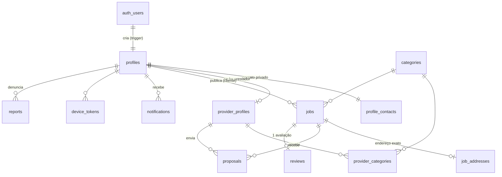

# Modelo de dados



## Tabelas

| Tabela | Para que serve | Quem lê | Quem escreve |
|---|---|---|---|
| `profiles` | Nome, foto, cidade, bio, papel (`cliente`/`prestador`/`admin`), bloqueado | Todos logados | Dono (exceto `role`/`is_blocked`), admin |
| `profile_contacts` | Telefone, WhatsApp, e-mail | Dono, admin e a contraparte de um serviço contratado | Dono |
| `provider_profiles` | Apresentação, cidades atendidas, raio, disponibilidade, nota média, nº de serviços, verificado | Todos logados | Dono (exceto nota/verificado), admin |
| `categories` | Categorias de serviço | Todos (inclusive sem login) | Admin |
| `provider_categories` | Categorias que o prestador atende | Todos logados | Dono (use a RPC `set_my_categories`) |
| `jobs` | Serviço publicado pelo cliente | Abertos: todos logados. Outros status: cliente, quem se candidatou, admin | Cliente (só enquanto `aberto`) |
| `job_addresses` | Rua, número, CEP, referência | Cliente, prestador escolhido, admin | Cliente |
| `proposals` | Candidatura: preço (ou null = a combinar), mensagem, prazo, data | Prestador autor, dono do serviço, admin | Prestador (só enquanto `pendente`) |
| `reviews` | Nota 1–5 + comentário, uma por serviço concluído | Todos logados (menos as ocultas) | Cliente do serviço |
| `notifications` | Notificações in-app | Dono | Somente o banco (triggers/RPC) |
| `device_tokens` | Tokens FCM para push | Dono | Dono |
| `reports` | Denúncias de usuário/serviço | Autor, admin | Qualquer logado cria; admin trata |

## Ciclo de vida

```
Serviço (jobs.status)                 Proposta (proposals.status)
─────────────────────                 ───────────────────────────
aberto ──accept_proposal──► em_andamento ──complete_job──► concluido ──► (avaliação)
  │                              │
  └──────── cancel_job ──────────┴──► cancelado

pendente ──accept_proposal──► aceita
   │ ├──── (outra aceita / reject_proposal / cancel_job) ──► recusada
   │ └──── withdraw_proposal ──► retirada
```

## Notificações geradas automaticamente

| Evento | Quem recebe | `type` |
|---|---|---|
| Serviço publicado | Prestadores disponíveis da mesma categoria que atendem a cidade | `novo_servico_na_regiao` |
| Proposta enviada | Cliente | `nova_proposta` |
| Cliente escolheu | Prestador escolhido / demais candidatos | `proposta_aceita` / `proposta_recusada` |
| Serviço concluído | Prestador | `servico_concluido` |
| Serviço cancelado | Candidatos | `servico_cancelado` |
| Avaliação feita | Prestador | `nova_avaliacao` |

## RPCs (funções chamadas pelo app)

| Função | Parâmetros | Quem usa |
|---|---|---|
| `search_jobs` | `p_query, p_category_id, p_city, p_min_budget, p_limit, p_offset` | Prestador (feed/busca) |
| `search_providers` | `p_category_id, p_city, p_limit, p_offset` | Cliente (explorar prestadores) |
| `set_my_categories` | `p_category_ids bigint[]` | Prestador |
| `set_my_role` | `p_role` (`cliente`/`prestador`) | Quem quiser mudar de papel |
| `accept_proposal` | `p_proposal_id` | Cliente |
| `reject_proposal` | `p_proposal_id` | Cliente |
| `withdraw_proposal` | `p_proposal_id` | Prestador |
| `complete_job` | `p_job_id` | Cliente |
| `cancel_job` | `p_job_id, p_reason` | Cliente / admin |
| `mark_notification_read` / `mark_all_notifications_read` / `unread_notifications_count` | — | Todos |
| `admin_dashboard` | — (retorna JSON) | Admin |
| `admin_set_user_blocked` | `p_user_id, p_blocked` | Admin |
| `admin_set_provider_verified` | `p_user_id, p_verified` | Admin |
| `admin_set_review_hidden` | `p_review_id, p_hidden` | Admin |

## Views

`job_candidates`, `my_proposals`, `my_job_history`, `provider_reviews`, `admin_users` —
todas com `security_invoker`, ou seja, respeitam as mesmas regras de acesso das tabelas.
